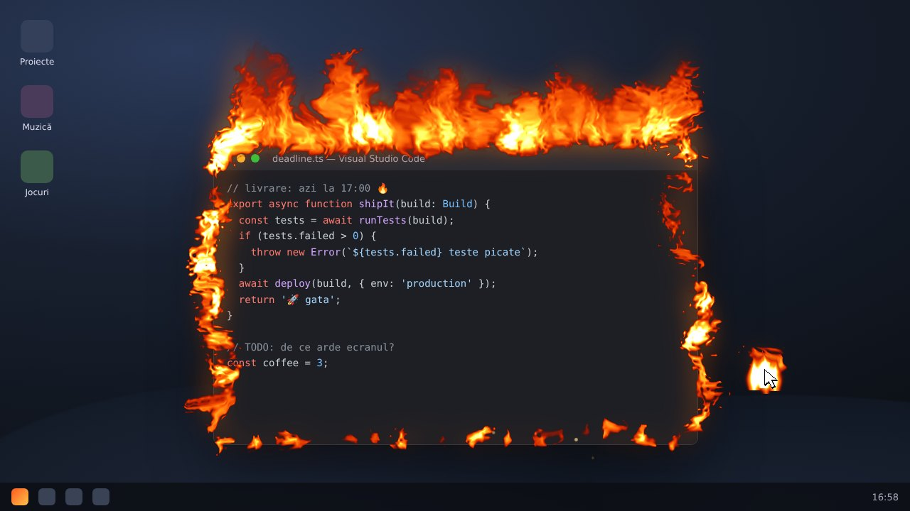
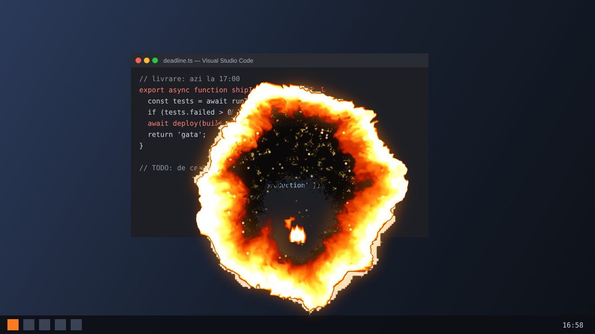
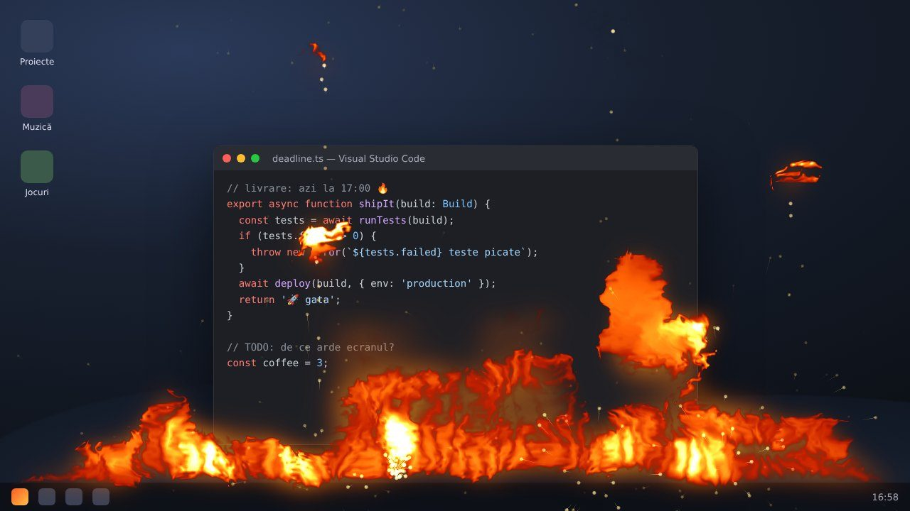
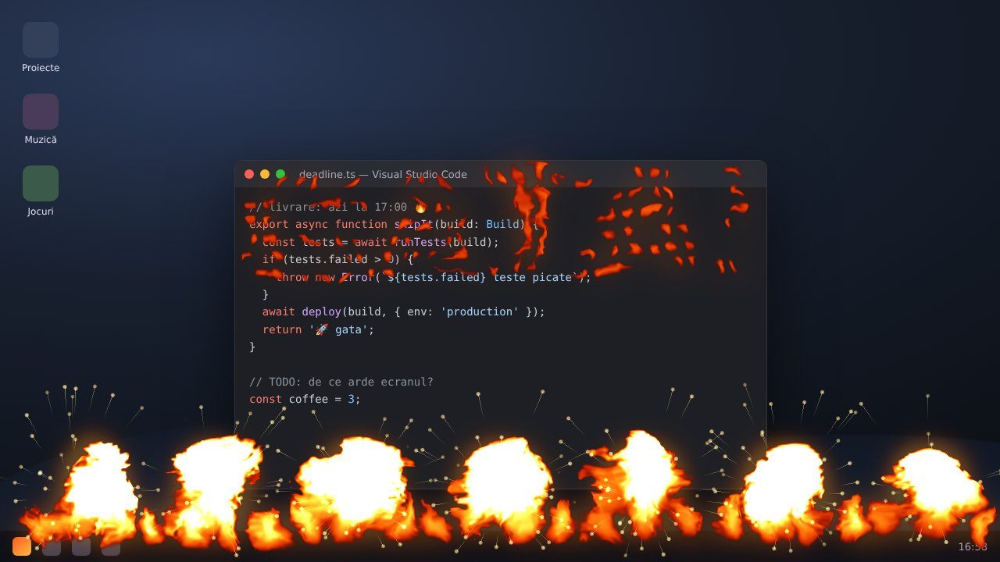
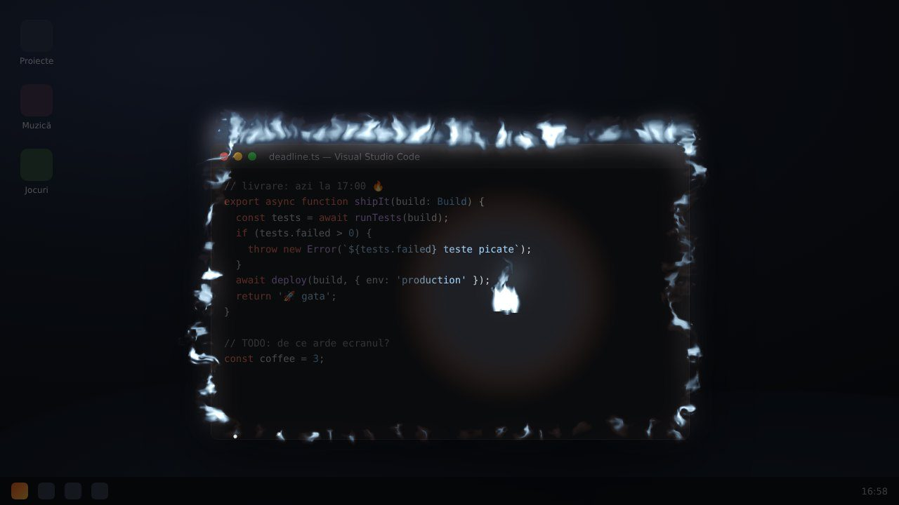
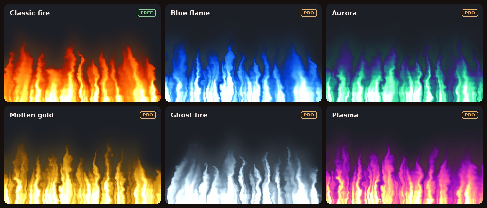

<p align="center">
  
</p>

<h1 align="center">Prăjeală</h1>

<p align="center">
  Foc pe ecran, pe aplicații și pe cursor.<br>
  <em>Fire on your screen, on your apps and around your cursor.</em>
</p>

<p align="center">
  <a href="#română">Română</a> · <a href="#english">English</a>
</p>

---

## Română

**Prăjeală** e un overlay transparent pentru desktop (Windows, macOS, Linux) care rulează o simulare de
fluid pe GPU și o desenează ca flăcări **deasupra tuturor aplicațiilor**, fără să-ți stea în cale:
fereastra e click-through, deci lucrezi normal, doar că ecranul arde.

- **Cursorul** devine sursă de foc: halo, coadă de flăcări sau „cometă” proporțională cu viteza, plus
  scântei și o explozie la fiecare click.
- **Aplicația activă** ia foc: flăcările ies din marginea de sus a ferestrei focalizate și ling laturile.
- **Ecranul** poate arde de la bază, pe fiecare monitor.

<p align="center"></p>

Plus patru moduri: **Arde tot** (desktopul arde ca hârtia), **Ritmul focului** (focul dansează pe muzică),
**Termen limită** (un cronometru de concentrare cu fitil) și **Mod Torță** (ecran întunecat, cursorul e o torță).

**Gratuit, cu upgrade opțional [Prăjeală Pro](#prăjeală-pro)** (plată unică): toate paletele, intensitatea
Inferno, foc pe toate monitoarele, Modul Torță, scenele Pro și peretele egalizator. Orice instalare începe cu 7 zile de Pro. Site: <https://fastuber.github.io/prajeala/>.

### Funcții

| | |
|---|---|
| Overlay | click-through, mereu deasupra, câte o fereastră pe fiecare monitor; se recreează automat când schimbi monitoarele sau rezoluția |
| Simulare | fluid pe GPU (WebGL2): injectare → vorticity → presiune (Jacobi) → advecție → flotabilitate; rulează la rezoluție redusă (`simScale`) și randează la rezoluția nativă |
| Cursor | moduri `off` / `halo` / `trail` / `comet`; mișcarea cursorului împinge fluidul |
| Click-uri | explozie de foc la click (necesită `uiohook-napi`) |
| Aplicații | foc pe conturul ferestrei active (necesită `get-windows`) |
| Ecran | foc care urcă de la baza fiecărui ecran |
| Scântei | particule CPU emise de cursor și de explozii |
| Palete | `classic`, `ember` (gratuite); `blue`, `green`, `plasma`, `aurora`, `gold`, `ghost` (Pro) |
| Intensități | `low`, `medium`, `high` (gratuite); `inferno` (Pro) |
| Setări | fereastră de setări cu toate opțiunile, previzualizare a paletelor și activarea licenței (ro/en) |

### Moduri

| | |
|---|---|
|  | **🔥 Arde tot** — desktopul tău real se încovoaie și arde ca o foaie de hârtie, pornind de la cursor, iar ecranul viu se vede prin cenușă. Clic pentru încă un focar, `Esc` ca să stingi. `Ctrl/Cmd + Alt + Shift + F`, tray sau setări; variante: fereastra activă sau o imagine aleasă. Captura stă doar în memorie. Pe macOS cere permisiunea **Screen Recording** (altfel poți arde o imagine). |
|  | **🎵 Ritmul focului** — focul cântă muzica: basul ridică flăcările, fiecare kick aruncă o minge de foc, snare-ul împrăștie scântei, un drop aprinde tot ecranul. Sursă: sunetul sistemului sau microfonul (oprit implicit). Analiza (32 de benzi, detecție de bătăi și drop-uri) rulează local, într-o fereastră ascunsă izolată; nu se înregistrează și nu se trimite nimic. Stilul **Egalizator** (un zid de flăcări pe benzi) e Pro. Pe Linux, sunetul sistemului vine din monitorul PulseAudio/PipeWire; pe macOS captura sunetului de sistem poate să nu fie disponibilă — folosește microfonul. |
|  | **⏳ Termen limită** — un cronometru de concentrare desenat de foc: un fitil arde de-a lungul marginii de jos, ultimul minut se încinge, ultimele zece secunde sunt numărate în flăcări, iar la zero tot ecranul ia foc și primești o notificare. 5 / 15 / 25 / 50 de minute sau cât vrei (1–180), cu pauză și „Stinge”, din tray sau din setări. |
|  | **🔦 Mod Torță** (Pro) — ecranul se întunecă, iar cursorul e o torță; fiecare foc luminează ce e în jurul lui. Scena **Bântuit** îl pornește cu foc fantomă. |

**Scene** — un click setează toată atmosfera: **Clasic**, **Șemineu**, **Discret** (gratuite), **Petrecere**,
**Infern**, **Bântuit** (Pro). În preajma unor zile anume (Focul lui Sumedru, Halloween, sărbătorile de iarnă)
fereastra de setări sugerează scena potrivită.

**Energie** — focul adoarme după 2 minute fără activitate (configurabil), trece pe **eco** pe baterie (30 fps,
simulare mai mică) sau se oprește de tot, se ascunde sub jocuri și filme pe tot ecranul și stă deasupra barei
de activități. Când nu arde nimic, overlay-ul nu mai desenează deloc.

### Instalare

Ai nevoie de **Node.js ≥ 22.12** și npm.

```bash
git clone https://github.com/FasTuber/prajeala.git
cd prajeala
npm install
npm start
```

`npm start` compilează sursele cu esbuild și pornește Electron. Aplicația apare doar în **tray** (nu are
fereastră proprie). Pentru instalatoare gata de distribuit vezi [Dezvoltare](#dezvoltare).

Cele două dependențe native sunt **opționale** — dacă nu se pot instala pe sistemul tău, aplicația pornește
oricum, doar cu funcțiile respective dezactivate:

- `uiohook-napi` → click-uri globale (explozii la click);
- `get-windows` → fereastra activă (foc pe aplicații).

### Prăjeală Pro

<p align="center"></p>

| | Gratuit | Pro |
|---|---|---|
| Cursor, explozii la click, scântei, foc pe fereastra activă și la baza ecranului | ✓ | ✓ |
| Palete | Foc clasic, Jar | toate 8 |
| Paletă personalizată (3 culori) și foc la tastare | — | ✓ |
| Intensitate Inferno | — | ✓ |
| Foc pe toate monitoarele | doar cel principal | ✓ |
| Arde tot, Termen limită, Ritmul focului (stilul Puls) | ✓ | ✓ |
| Ritmul focului: stilul Egalizator | — | ✓ |
| Mod Torță; scenele Petrecere, Infern, Bântuit | — | ✓ |

- Primele **7 zile** după instalare ai tot Pro, gratuit. Apoi aplicația revine la varianta gratuită, fără să-ți
  piardă setările: alegerile Pro revin singure după activare.
- Cumperi din fereastra **Setări…** (butonul „Cumpără Pro”), primești cheia pe e-mail și o lipești în același loc.
  O cheie merge pe până la 3 calculatoare; „Dezactivează pe acest calculator” eliberează locul.
- Activarea se face o singură dată online; verificarea periodică nu îți ia niciodată Pro doar pentru că ești offline.
- Pentru autor: configurarea magazinului, cheile offline și lansarea sunt descrise în [`docs/MONETIZARE.md`](docs/MONETIZARE.md).

### Fereastra de setări și meniul din tray

**Setări…** din tray (sau pornirea aplicației a doua oară) deschide fereastra de setări: toate opțiunile de mai jos,
paletele cu previzualizare și cardul Prăjeală Pro. La prima pornire fereastra se deschide singură, cu un scurt
bun venit. Fereastra arde și ea, ca orice aplicație activă — e o previzualizare live a setărilor.

Click pe icoana cu flacără din tray:

- **starea Pro** (probă / Pro activ / „Ia Prăjeală Pro…”);
- **Pauză / Reluare** — oprește randarea fără să închidă aplicația;
- **Intensitate** — Low / Medium / High / Inferno;
- **Paletă** — Classic / Embers / Blue / Green / Plasma / Aurora / Molten gold / Ghost (cele marcate „— Pro” deschid cardul Pro);
- **🎬 Scenă** — Clasic / Șemineu / Discret / Petrecere / Infern / Bântuit;
- **Cursor** — Off / Halo / Trail / Comet;
- **🔥 Arde ecranul** (și submeniul pentru fereastra activă / o imagine), **🎵 Ritmul focului** (sursa),
  **⏳ Termen limită** (5–50 de minute, pauză, stinge; arată timpul rămas);
- comutatoare: **Explozii la click**, **Foc pe fereastra activă**, **Foc la baza ecranului**, **🔦 Mod Torță**, **Scântei**,
  **Adoarme când nu ești la calculator**, **Mod joc**;
- **FPS maxim**, **Pornire la login**, **HUD de debug**;
- **Test explozie**, **Setări…**, **Deschide fișierul de setări**, **Ieșire**.

Meniul și fereastra sunt în română când sistemul e în română, altfel în engleză.

### Scurtături globale

| Scurtătură | Acțiune |
|---|---|
| `Ctrl/Cmd + Shift + F` | pauză / reluare |
| `Ctrl/Cmd + Shift + Q` | ieșire |
| `Ctrl/Cmd + Shift + ↑` / `↓` | intensitate mai mare / mai mică |
| `Ctrl/Cmd + Shift + B` | explozie de test la cursor |
| `Ctrl/Cmd + Alt + Shift + F` | Arde tot (`Esc` stinge) |

(`Cmd` pe macOS, `Ctrl` pe Windows și Linux.)

### Opțiuni din linia de comandă

```
electron . [opțiuni]        # sau: npm start -- [opțiuni]
```

| Opțiune | Efect |
|---|---|
| `--debug-hud` | pornește cu panoul de diagnostic (fps, dimensiunea simulării, emițători) |
| `--smoke` | mod de test: randează câteva cadre, tipărește `PRAJEALA_SMOKE_RESULT {json}` și iese cu 0/1 |
| `--smoke-frames=N` | câte cadre să randeze în modul `--smoke` (implicit 90) |
| `--software-gl` | forțează randarea software (SwiftShader) — util în mașini virtuale / CI |
| `--no-hooks` | nu încărca `uiohook-napi` (fără explozii la click) |
| `--no-active-window` | nu urmări fereastra activă |
| `--display=N` | overlay doar pe monitorul cu indexul N |
| `--cursor-hz=N` | frecvența de citire a poziției cursorului (implicit ~120) |
| `--window-hz=N` | frecvența de interogare a ferestrei active |
| `--no-sandbox` | necesar când rulezi Electron ca root (Linux) |
| `--settings` | deschide fereastra de setări la pornire |
| `--force-tier=free\|pro` | doar în dezvoltare (build nepachetat): `free` sare peste perioada de probă, `pro` deblochează tot |

### Fișierul de setări

Setările se salvează ca JSON în `prajeala-settings.json`, în directorul `userData` al Electron
(folderul se numește `prajeala` când rulezi din surse și `Prajeala` în varianta instalată):

| OS | Cale |
|---|---|
| Windows | `%APPDATA%\prajeala\prajeala-settings.json` |
| macOS | `~/Library/Application Support/prajeala/prajeala-settings.json` |
| Linux | `~/.config/prajeala/prajeala-settings.json` |

Fișierul e validat la citire (`normalizeSettings` din `src/shared/settings.ts`): valorile invalide cad pe
implicit, numerele sunt limitate la intervalele permise (`simScale` 0.1–1, `maxFps` 15–240,
`pressureIterations` 0–64, `idleSleepSeconds` 20–1800, `audioSensitivity` 0–1, `focusMinutes` 1–180). Poți șterge fișierul oricând ca să revii la setările implicite.

Lângă el stă `prajeala-license.json` (data primei porniri și licența activă, fără alte date personale).

### Cum funcționează

Procesul principal Electron deschide câte o fereastră transparentă, fără ramă și click-through pe fiecare
monitor, citește poziția cursorului la ~120 Hz, click-urile globale și fereastra activă, și le trimite
prin IPC în renderer. Renderer-ul rulează o simulare de fluid pe GPU (texturi ping-pong de viteză și
temperatură, vorticity confinement, rezolvarea presiunii cu Jacobi, advecție semi-Lagrangiană, flotabilitate)
în care cursorul, click-urile, conturul ferestrei active și baza ecranului sunt **emițători** de căldură și
viteză. Temperatura e trecută printr-o paletă (LUT) și compozitată premultiplied peste fundalul transparent.

Detalii, diagrame și decizii: [`docs/PLAN.md`](docs/PLAN.md).

### Note pe platforme

- **Windows** — merge direct; `uiohook-napi` și `get-windows` au binare precompilate.
- **macOS** — click-urile globale (`uiohook-napi`) cer permisiunea **Accessibility**, iar titlurile ferestrelor
  (`get-windows`) cer **Screen Recording** (System Settings → Privacy & Security). Fără ele, aplicația merge
  dar fără explozii la click / foc pe aplicații. Aplicația rulează ca agent de tray (fără icoană în Dock).
- **Linux** — e nevoie de un **compositor** (X11 cu compoziție sau Wayland) pentru ferestre transparente.
  Pe Wayland, poziția globală a cursorului și fereastra activă pot fi limitate de compositor. Ca root,
  pornește cu `--no-sandbox`.

### Performanță

- `simScale` (implicit 0.25) e cel mai important buton: simularea rulează la `simScale × rezoluția ecranului`.
  Pe laptopuri cu GPU integrat, 0.15–0.2 arată încă bine și consumă mult mai puțin.
- `maxFps` (implicit 60): 30 e suficient pentru efect „ambient” și înjumătățește consumul.
- `pressureIterations` (implicit 12): mai puține iterații = mai rapid, flăcări puțin mai „moi”.
- Intensitatea `inferno` crește raza și bugetul de scântei — e gândită pentru demo, nu pentru lucru.
- Dacă nu există `EXT_color_buffer_float`, simularea cade pe texturi RGBA8 (merge, dar mai puțin fin).

### Dezvoltare

```bash
npm run build        # bundle main / preload / renderer în dist/ (esbuild)
npm run build:watch  # rebuild la fiecare modificare
npm run dev          # build + pornire cu --debug-hud
npm run typecheck    # tsc --noEmit
npm run lint         # eslint .
npm test             # vitest (module pure din src/shared)
npm run smoke        # build + pornire în --smoke (sub Xvfb dacă nu există DISPLAY) → smoke-report.json
npm run icons        # regenerează assets/** (icoane desenate procedural, fără dependențe)
npm run license -- keygen | issue --to "Nume" | verify <cheie>   # chei de licență offline (vezi docs/MONETIZARE.md)
npm run pack         # build + director neîmpachetat în release/
npm run dist         # build + instalatoare (NSIS / DMG+zip / AppImage+deb) în release/
```

`scripts/smoke.mjs` acceptă `--frames=N`, `--timeout=S`, `--keep` (pornește aplicația normal și o lasă
deschisă) și trece orice altă opțiune mai departe către aplicație; `ELECTRON_BIN` suprascrie binarul Electron.

Structura proiectului:

```
src/main/       procesul principal: overlay-uri, tracker cursor/fereastră, tray, scurtături, setări,
                fereastra de setări, licențe (license/), --smoke
src/preload/    punțile contextBridge: window.prajeala (overlay) și window.prajealaUi (setări)
src/renderer/   simularea WebGL2, emițătorii, scânteile, HUD-ul de debug; settings/ = fereastra de setări
src/shared/     contractul comun: settings, ipc, palettes, pro (gratuit/Pro), license, product, i18n (pure, testate)
scripts/        build.mjs (esbuild), smoke.mjs, gen-icons.mjs, license.mjs (chei offline)
tests/          teste unitare
assets/         icoane generate (app + tray)
site/           pagina de prezentare (GitHub Pages) + imagini
docs/           PLAN.md, MONETIZARE.md
```

CI (`.github/workflows/ci.yml`) rulează typecheck, lint, teste, build și smoke-test-ul sub Xvfb (overlay +
fereastra de setări) la fiecare push; pe tag-uri `v*` (sau manual) construiește instalatoarele pentru Windows,
macOS și Linux, iar pe tag-uri le adună într-un release ciornă pe GitHub. `.github/workflows/pages.yml` publică
`site/` pe GitHub Pages.

### Licență

[MIT](LICENSE) © 2026 Mihai Balan (FasTuber)

---

## English

**Prăjeală** (Romanian for "a good frying") is a transparent, click-through desktop overlay for Windows,
macOS and Linux that runs a GPU fluid simulation and draws it as fire **on top of everything**, while you
keep working underneath:

- the **cursor** becomes a fire source (halo, trail or velocity-scaled comet, sparks, a burst on every click);
- the **focused application window** catches fire along its frame;
- the **screen** can burn from the bottom edge, on every monitor.

Plus four modes: **Burn it all** (the desktop burns like paper), **Fire rhythm** (the fire dances to your music),
**Deadline** (a focus timer with a burning fuse) and **Torch mode** (dark screen, your cursor is a torch).

It is **free**, with an optional one-time **Prăjeală Pro** upgrade (all palettes, Inferno intensity, fire on
every monitor, Torch mode, the Pro scenes and the equaliser wall). Every install starts with a 7-day Pro trial. Website: <https://fastuber.github.io/prajeala/>.

### Features

- Click-through, always-on-top overlay, one window per display, recreated automatically on display changes.
- WebGL2 fluid simulation (splat → vorticity → Jacobi pressure → advection → buoyancy), simulated at a
  reduced resolution (`simScale`) and rendered at native resolution.
- Cursor modes `off` / `halo` / `trail` / `comet`; cursor movement pushes the fluid.
- Click bursts (needs `uiohook-napi`), fire on the active window frame (needs `get-windows`),
  screen-bottom fire, CPU spark particles.
- Palettes `classic`, `ember` (free) and `blue`, `green`, `plasma`, `aurora`, `gold`, `ghost` (Pro);
  intensities `low`, `medium`, `high` (free) and `inferno` (Pro).
- A settings window with every option, palette previews and licence activation (English / Romanian).

### Modes

| | |
|---|---|
|  | **🔥 Burn it all** — your real desktop curls and burns like paper from the cursor outwards, with the live screen showing through the ash. Click for more fires, `Esc` to put it out. `Ctrl/Cmd + Alt + Shift + F`, the tray or the settings window; also the active window only, or a picture you choose. The snapshot only lives in memory. macOS needs the **Screen Recording** permission (or burn a picture instead). |
|  | **🎵 Fire rhythm** — the fire plays your music: bass lifts the flames, kicks shoot fireballs, snares throw sparks, a drop sets the screen ablaze. Source: system sound or the microphone (off by default). Analysis (32 bands, beat and drop detection) runs locally in an isolated hidden window; nothing is recorded or sent. The **Equaliser** style (a wall of flames per band) is Pro. Linux captures the PulseAudio/PipeWire monitor; macOS may not offer system sound — use the microphone. |
|  | **⏳ Deadline** — a focus timer drawn by the fire: a fuse burns along the bottom, the last minute heats up, the last ten seconds are written in flames and zero ends in a blaze plus a notification. 5 / 15 / 25 / 50 minutes or your own (1–180), with pause and stop, from the tray or the settings window. |
|  | **🔦 Torch mode** (Pro) — the screen goes dark and your cursor is a torch; every fire lights up its surroundings. The **Haunted** scene turns it on with ghost fire. |

**Scenes** — one click sets the mood: **Classic**, **Fireplace**, **Subtle** (free), **Party**, **Inferno**,
**Haunted** (Pro). Around Sumedru, Halloween and the winter holidays the settings window suggests the
matching scene.

**Energy** — the fire sleeps after 2 minutes away (configurable), drops to **eco** on battery (30 fps, smaller
simulation) or pauses, hides under fullscreen games and videos and stays above the taskbar. When nothing
burns, the overlay draws nothing at all.

### Install

Requires **Node.js ≥ 22.12**.

```bash
git clone https://github.com/FasTuber/prajeala.git
cd prajeala
npm install
npm start
```

The app lives in the **system tray** only. Both native modules are **optional** dependencies: if they fail to
install, the app still runs with click bursts / active-window fire disabled.

### Prăjeală Pro

| | Free | Pro |
|---|---|---|
| Cursor fire, click bursts, sparks, active-window and screen-bottom fire | ✓ | ✓ |
| Palettes | Classic fire, Embers | all 8 |
| Custom palette (pick 3 colours) and typing fire | — | ✓ |
| Inferno intensity | — | ✓ |
| Fire on every monitor | primary only | ✓ |
| Burn it all, Deadline, Fire rhythm (Pulse style) | ✓ | ✓ |
| Fire rhythm: Equaliser style | — | ✓ |
| Torch mode; Party, Inferno and Haunted scenes | — | ✓ |

Pro is a one-time purchase from the settings window (“Buy Pro”); paste the e-mailed licence key in the same
place. A key works on up to 3 computers. Activation happens once online; the weekly background check never
removes Pro just because you are offline. Store setup, offline keys and release steps for the author:
[`docs/MONETIZARE.md`](docs/MONETIZARE.md) (Romanian).

### Settings window and tray menu

**Settings…** in the tray (or launching the app a second time) opens the settings window: every option, palette
previews and the Prăjeală Pro card. It opens by itself with a short welcome on the first launch.

Tray: Pro status · Pause/Resume · Scene · Intensity · Palette · Cursor mode · Burn the screen (+ window / picture) ·
Fire rhythm source · Deadline timer (presets, pause, stop, time left) · toggles for click bursts, active-window
fire, screen-bottom fire, Torch mode, sparks, idle sleep and game mode · max FPS · quality · launch at login · debug HUD · test burst · Settings… ·
Quit. Pro-only entries are marked “— Pro” and open the Pro card.

### Global shortcuts

| Shortcut | Action |
|---|---|
| `Ctrl/Cmd + Shift + F` | pause / resume |
| `Ctrl/Cmd + Shift + Q` | quit |
| `Ctrl/Cmd + Shift + ↑` / `↓` | intensity up / down |
| `Ctrl/Cmd + Shift + B` | test burst at the cursor |
| `Ctrl/Cmd + Alt + Shift + F` | Burn it all (`Esc` puts it out) |

### Command-line flags

| Flag | Effect |
|---|---|
| `--debug-hud` | start with the on-screen diagnostics panel |
| `--smoke` | test mode: render a few frames, print `PRAJEALA_SMOKE_RESULT {json}`, exit 0/1 |
| `--smoke-frames=N` | frames to render in `--smoke` mode (default 90) |
| `--software-gl` | force software rendering (SwiftShader) — VMs / CI |
| `--no-hooks` | do not load `uiohook-napi` (no click bursts) |
| `--no-active-window` | do not track the active window |
| `--display=N` | overlay only display index N |
| `--cursor-hz=N` | cursor polling rate (default ~120) |
| `--window-hz=N` | active-window polling rate |
| `--no-sandbox` | required when running Electron as root on Linux |
| `--settings` | open the settings window on start |
| `--force-tier=free\|pro` | development builds only: `free` skips the trial, `pro` unlocks everything |

### Settings file

`prajeala-settings.json` inside Electron's `userData` directory (folder `prajeala` when running from source,
`Prajeala` for packaged builds): `%APPDATA%\prajeala\` on Windows, `~/Library/Application Support/prajeala/`
on macOS, `~/.config/prajeala/` on Linux. The file is validated on load (`src/shared/settings.ts`): invalid
values fall back to defaults and numbers are clamped (`simScale` 0.1–1, `maxFps` 15–240,
`pressureIterations` 0–64, `idleSleepSeconds` 20–1800, `audioSensitivity` 0–1, `focusMinutes` 1–180). Delete it to reset. `prajeala-license.json` next to it holds the first-run date and
the active licence.

### How it works

The Electron main process opens a transparent, frameless, click-through window on each display, samples the
cursor at ~120 Hz, listens for global clicks and the active window, and streams all of it to the renderer
over IPC. The renderer runs a GPU fluid simulation in which the cursor, clicks, the active window's frame
and the screen bottom are heat/velocity **emitters**; temperature goes through a palette LUT and is
composited premultiplied over the transparent background. See [`docs/PLAN.md`](docs/PLAN.md) (Romanian).

### Platform notes

- **Windows** — works out of the box.
- **macOS** — `uiohook-napi` needs the **Accessibility** permission for global clicks and `get-windows` needs
  **Screen Recording** for window titles. The app runs as a tray agent (no Dock icon).
- **Linux** — a **compositor** is required for transparent windows (composited X11 or Wayland); Wayland may
  restrict global cursor position / active-window info. Run with `--no-sandbox` as root.

### Performance tips

Lower `simScale` (0.15–0.2 on integrated GPUs), cap `maxFps` at 30 for an ambient effect, reduce
`pressureIterations`; `inferno` is a demo setting. Without `EXT_color_buffer_float` the simulation falls back
to RGBA8 textures.

### Development

`npm run build` / `build:watch` / `dev` / `typecheck` / `lint` / `test` / `smoke` / `icons` / `license` / `pack` / `dist` —
see the Romanian section above for what each does, and the project layout there. CI runs typecheck, lint,
tests, build and the Xvfb smoke test (overlay + settings window) on every push, builds installers on `v*` tags or
manual dispatch and collects them into a draft GitHub release on tags; `pages.yml` deploys `site/` to GitHub Pages.

### License

[MIT](LICENSE) © 2026 Mihai Balan (FasTuber)
