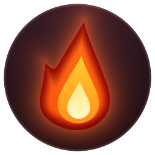

<p align="center">
  
</p>

<h1 align="center">Prăjeală</h1>

<p align="center">
  Foc pe ecran, pe aplicații și pe cursor.<br>
  <em>Fire on your screen, on your apps and around your cursor.</em>
</p>

<p align="center">
  <a href="#română">Română</a> · <a href="#english">English</a>
</p>

---

## Română

**Prăjeală** e un overlay transparent pentru desktop (Windows, macOS, Linux) care rulează o simulare de
fluid pe GPU și o desenează ca flăcări **deasupra tuturor aplicațiilor**, fără să-ți stea în cale:
fereastra e click-through, deci lucrezi normal, doar că ecranul arde.

- **Cursorul** devine sursă de foc: halo, coadă de flăcări sau „cometă” proporțională cu viteza, plus
  scântei și o explozie la fiecare click.
- **Aplicația activă** ia foc: flăcările ies din marginea de sus a ferestrei focalizate și ling laturile.
- **Ecranul** poate arde de la bază, pe fiecare monitor.

> Capturi de ecran: _în curând_ (`docs/screenshots/`).

### Funcții

| | |
|---|---|
| Overlay | click-through, mereu deasupra, câte o fereastră pe fiecare monitor; se recreează automat când schimbi monitoarele sau rezoluția |
| Simulare | fluid pe GPU (WebGL2): injectare → vorticity → presiune (Jacobi) → advecție → flotabilitate; rulează la rezoluție redusă (`simScale`) și randează la rezoluția nativă |
| Cursor | moduri `off` / `halo` / `trail` / `comet`; mișcarea cursorului împinge fluidul |
| Click-uri | explozie de foc la click (necesită `uiohook-napi`) |
| Aplicații | foc pe conturul ferestrei active (necesită `get-windows`) |
| Ecran | foc care urcă de la baza fiecărui ecran |
| Scântei | particule CPU emise de cursor și de explozii |
| Teme | `classic`, `blue`, `green`, `plasma`, `ember`, `ice` (gheață/apă — curge în jos), `electric` (arcuri care trosnesc), `neon` (tuburi strălucitoare); fiecare temă = paletă + parametri de simulare; import/export JSON |
| Intensități | `low`, `medium`, `high`, `inferno` |
| Sunet | focul pulsează după muzică: microfon sau audio de sistem (`getUserMedia`), benzi bass/mid/high + detecție de beat; nimic nu se înregistrează sau trimite |
| Tastare | scântei și un puf de căldură la fiecare tastă (necesită `uiohook-napi`); procesul principal trimite doar *categoria* tastei (literă / spațiu / Enter / ștergere / navigare), niciodată tasta |
| Free / Pro | versiunea Free are paleta `classic`, intensitate până la `medium`, fără foc pe ferestre, fără sunet, fără teme importate și fără foc la tastare; **Pro** deblochează tot — vezi [Prăjeală Pro](#pro) |

### Instalare

Ai nevoie de **Node.js ≥ 22.12** și npm.

```bash
git clone https://github.com/FasTuber/prajeala.git
cd prajeala
npm install
npm start
```

`npm start` compilează sursele cu esbuild și pornește Electron. Aplicația apare doar în **tray** (nu are
fereastră proprie). Pentru instalatoare gata de distribuit vezi [Dezvoltare](#dezvoltare).

Cele două dependențe native sunt **opționale** — dacă nu se pot instala pe sistemul tău, aplicația pornește
oricum, doar cu funcțiile respective dezactivate:

- `uiohook-napi` → click-uri globale (explozii la click) și taste (foc la tastare);
- `get-windows` → fereastra activă (foc pe aplicații).

### Meniul din tray

Click pe icoana cu flacără din tray:

- **Pauză / Reluare** — oprește randarea fără să închidă aplicația;
- **Intensitate** — Low / Medium / High / Inferno;
- **Temă** — Classic / Blue / Green / Plasma / Ember / Ice & water / Electricity / Neon, temele importate,
  **Import theme…**, **Export current theme…**, **Open themes folder**;
- **Cursor** — Off / Halo / Trail / Comet;
- comutatoare: **Explozii la click**, **Foc pe fereastra activă**, **Foc la baza ecranului**, **Scântei**,
  **Sound reactive** (Pro), **Typing fire** (Pro, necesită `uiohook-napi`);
- **Sound** — starea curentă (ascultă / permisiune refuzată / fără dispozitiv), sursa (microfon sau audio de
  sistem) și sensibilitatea (Low / Normal / High / Max);
- **FPS maxim**, **Pornire la login**, **HUD de debug**;
- **Licență: Free / Pro** — introdu cheia (fereastră sau din clipboard), verifică online, cumpără Pro
  (opțiunile marcate cu „(Pro)” sunt dezactivate în Free);
- **Test explozie**, **Ieșire**.

### Teme (format JSON)

O temă = o paletă de culori + „aroma” simulării. Temele încorporate (una pentru fiecare paletă) pot fi
exportate din tray ca punct de plecare; fișierele importate ajung în `userData/themes/<id>.json` și apar
în meniul **Temă** (Pro). Un fișier de temă:

```json
{
  "format": "prajeala-theme",
  "version": 1,
  "id": "lava-lamp",
  "name": "Lava lamp",
  "stops": [[0, 0, 0, 0], [0.5, 0.9, 0.2, 0.6], [1, 1, 1, 1]],
  "spark": [1, 0.5, 0.9],
  "sim":  { "buoyancy": 0.5, "curl": 1.5, "cooling": 1, "heatLoss": 1, "velocityLoss": 1, "flow": 1, "maxSpeed": 1 },
  "look": { "detail": 0.9, "glow": 0.8, "smoke": 0.14, "smokeColor": [0.07, 0.06, 0.06], "noiseSpeed": 1 }
}
```

- `stops` — opriri `[t, r, g, b]` (t crescător de la 0 la 1, culori 0–1); `spark` — culoarea scânteilor;
- `sim` — multiplicatori peste presetul de intensitate: `buoyancy` (negativ = curge în jos, ca `ice`),
  `curl` (vârtej), `cooling` / `heatLoss` (cât trăiesc flăcările), `velocityLoss` (vâscozitate),
  `flow` (direcția împingerii emițătorilor: 1 sus, −1 jos), `maxSpeed`;
- `look` — `detail` (eroziune cu zgomot: limbi zdrențuite vs tuburi netede), `glow`, `smoke` + `smokeColor`,
  `noiseSpeed` (cât de repede „trosnește” textura).

Câmpurile lipsă iau valorile implicite, numerele sunt limitate la intervale sigure, iar fișierele invalide
sunt ignorate cu un avertisment în log (`src/shared/theme.ts` → `validateTheme`).

### Foc la tastare

Cu **Typing fire** pornit, fiecare tastă apăsată (oriunde în sistem, prin `uiohook-napi`) aruncă scântei și un
puf de căldură la cursor — sau, când mouse-ul e pe alt monitor, la marginea de jos a ferestrei active. Tastatul
rapid acumulează un „combo” care face pufurile mai mari; **Enter** face o mică explozie, **Backspace** un puf
rece, fumuriu. Confidențialitate: hook-ul clasifică tasta pe loc în una din categoriile
`char / space / enter / backspace / modifier / navigation / other` și doar categoria ajunge în renderer;
codul tastei nu e nici memorat, nici logat, nici trimis. Setare `typingFire` (implicit oprit); `--no-hooks`
dezactivează complet hook-ul. În mock: tasta `k` comută, `?typing=sim` tastează singur.

### Reacție la sunet

Cu **Sound reactive** pornit, renderer-ul deschide un `AudioContext` + `AnalyserNode` peste fluxul de la
`getUserMedia` și calculează la fiecare cadru nivelul general, benzile **bass / mid / high** (cu auto-nivel,
ca muzica încet să conteze la fel ca cea tare) și un **beat** (energia bass-ului față de media ultimei
secunde). Flăcările cresc cu nivelul, raza se umflă cu bass-ul, vârtejul urmează înaltele, baza ecranului
„respiră” pe beat, iar un beat puternic face o mică explozie la cursor. Sunetul nu părăsește niciodată
procesul: nu se înregistrează, nu se redă, nu se trimite nicăieri.

- **Microfon** — merge peste tot; permisiunea e cerută o singură dată (macOS: din procesul principal, deci
  apare dialogul de sistem; aplicația împachetată are `NSMicrophoneUsageDescription`).
- **Audio de sistem** — pe **Windows** prin loopback (`setDisplayMediaRequestHandler` + `audio: 'loopback'`),
  pe Linux prin dispozitivul „Monitor of …” al PulseAudio/PipeWire dacă e expus; altfel cade automat pe
  microfon (starea din tray spune ce ascultă). macOS nu oferă loopback fără drivere terțe.
- Setări: `audioReactive` (implicit oprit), `audioSource` (`microphone` / `system`), `audioGain` (0.25–4).
- În browser / pentru capturi: `?audio=sim` folosește o piesă sintetică (kick la 124 bpm) fără microfon;
  tasta `m` comută reacția la sunet în mock.

<a name="pro"></a>
### Prăjeală Pro

| | Free | Pro |
|---|---|---|
| Teme | `classic` | toate + teme importate (JSON) |
| Intensitate | până la `medium` | până la `inferno` |
| Foc pe fereastra activă | – | ✓ |
| Reacție la sunet | – | ✓ |
| Foc la tastare | – | ✓ |
| Cursor, click-uri, foc la baza ecranului, scântei | ✓ | ✓ |

Limitele stau într-un singur loc, `FREE_LIMITS` din `src/shared/license.ts`; procesul principal trimite
renderer-ului **setările efective** (cele salvate, tăiate la nivelul licenței), deci alegerile tale rămân în
fișier și revin când licența e activă.

**Cum activezi.** Tray → *Licență* → *Enter licence key…* (sau *Activate key from clipboard*, sau
`--license=CHEIE` la pornire). Sunt acceptate două formate:

1. **Cheie semnată** `PRAJ1.<payload>.<semnătură>` — emisă de vânzător după cumpărare, verificată
   **offline** (Ed25519) cu cheia publică compilată în aplicație. Nu are nevoie de internet niciodată.
2. **Cheie brută Lemon Squeezy** (`xxxxxxxx-xxxx-xxxx-xxxx-xxxxxxxxxxxx`, cea din e-mailul de la Lemon
   Squeezy) — are nevoie de internet o dată, la activare (`/v1/licenses/activate`), după care merge
   offline 30 de zile de la ultima verificare reușită.

Cheia se salvează în `prajeala-license.json`, lângă fișierul de setări. Comutatorul **Re-verify online
periodically** (setarea `licenseOnlineCheck`, implicit pornit) re-validează cheia la Lemon Squeezy o dată pe
săptămână, ca să prindă rambursările; fără rețea se păstrează ultima stare. O cheie semnată e retrogradată
doar dacă Lemon Squeezy o raportează explicit `disabled` / `expired`.

**Pentru vânzător** (o singură dată):

```bash
npm run license:keygen                  # license/private.key + license/public.key (folderul e în .gitignore)
export PRAJEALA_LICENSE_PUBLIC_KEY=$(cat license/public.key)   # sau lasă fișierul; build.mjs îl citește
export PRAJEALA_LS_STORE_ID=12345 PRAJEALA_LS_PRODUCT_ID=67890 # opțional: acceptă doar cheile produsului tău
export PRAJEALA_BUY_URL=https://magazinul-tau.lemonsqueezy.com/checkout/buy/…
npm run dist                            # instalatoare cu cheia publică + URL-ul de cumpărare incluse
```

Pentru fiecare client (manual sau dintr-un webhook `order_created`):

```bash
npm run license:sign -- --email=ana@example.com --name="Ana Pop" --key=<cheia Lemon Squeezy> [--expires=2027-12-31]
npm run license:sign -- --verify=PRAJ1....      # verifică o cheie cu license/public.key
```

Fără cheie publică configurată, build-ul avertizează și acceptă doar chei brute Lemon Squeezy (activare online).
În CI, pune cheia publică în secretul `PRAJEALA_LICENSE_PUBLIC_KEY`.

### Scurtături globale

| Scurtătură | Acțiune |
|---|---|
| `Ctrl/Cmd + Shift + F` | pauză / reluare |
| `Ctrl/Cmd + Shift + Q` | ieșire |
| `Ctrl/Cmd + Shift + ↑` / `↓` | intensitate mai mare / mai mică |
| `Ctrl/Cmd + Shift + B` | explozie de test la cursor |

(`Cmd` pe macOS, `Ctrl` pe Windows și Linux.)

### Opțiuni din linia de comandă

```
electron . [opțiuni]        # sau: npm start -- [opțiuni]
```

| Opțiune | Efect |
|---|---|
| `--debug-hud` | pornește cu panoul de diagnostic (fps, dimensiunea simulării, emițători) |
| `--smoke` | mod de test: randează câteva cadre, tipărește `PRAJEALA_SMOKE_RESULT {json}` și iese cu 0/1 |
| `--smoke-frames=N` | câte cadre să randeze în modul `--smoke` (implicit 90) |
| `--software-gl` | forțează randarea software (SwiftShader) — util în mașini virtuale / CI |
| `--no-hooks` | nu încărca `uiohook-napi` (fără explozii la click, fără foc la tastare) |
| `--no-active-window` | nu urmări fereastra activă |
| `--display=N` | overlay doar pe monitorul cu indexul N |
| `--cursor-hz=N` | frecvența de citire a poziției cursorului (implicit ~120) |
| `--window-hz=N` | frecvența de interogare a ferestrei active |
| `--license=CHEIE` | activează cheia de licență la pornire (semnată sau Lemon Squeezy) |
| `--license-window` | deschide fereastra de licență la pornire |
| `--no-sandbox` | necesar când rulezi Electron ca root (Linux) |

### Fișierul de setări

Setările se salvează ca JSON în `prajeala-settings.json`, în directorul `userData` al Electron
(folderul se numește `prajeala` când rulezi din surse și `Prajeala` în varianta instalată):

| OS | Cale |
|---|---|
| Windows | `%APPDATA%\prajeala\prajeala-settings.json` |
| macOS | `~/Library/Application Support/prajeala/prajeala-settings.json` |
| Linux | `~/.config/prajeala/prajeala-settings.json` |

Fișierul e validat la citire (`normalizeSettings` din `src/shared/settings.ts`): valorile invalide cad pe
implicit, numerele sunt limitate la intervalele permise (`simScale` 0.1–1, `maxFps` 15–240,
`pressureIterations` 0–64). Poți șterge fișierul oricând ca să revii la setările implicite. Licența stă
separat, în `prajeala-license.json` din același folder (ștergerea lui = revenire la Free).

### Cum funcționează

Procesul principal Electron deschide câte o fereastră transparentă, fără ramă și click-through pe fiecare
monitor, citește poziția cursorului la ~120 Hz, click-urile globale și fereastra activă, și le trimite
prin IPC în renderer. Renderer-ul rulează o simulare de fluid pe GPU (texturi ping-pong de viteză și
temperatură, vorticity confinement, rezolvarea presiunii cu Jacobi, advecție semi-Lagrangiană, flotabilitate)
în care cursorul, click-urile, conturul ferestrei active și baza ecranului sunt **emițători** de căldură și
viteză. Temperatura e trecută printr-o paletă (LUT) și compozitată premultiplied peste fundalul transparent.

Detalii, diagrame și decizii: [`docs/PLAN.md`](docs/PLAN.md).

### Note pe platforme

- **Windows** — merge direct; `uiohook-napi` și `get-windows` au binare precompilate.
- **macOS** — click-urile globale (`uiohook-napi`) cer permisiunea **Accessibility**, iar titlurile ferestrelor
  (`get-windows`) cer **Screen Recording** (System Settings → Privacy & Security). Fără ele, aplicația merge
  dar fără explozii la click / foc pe aplicații. Reacția la sunet cere **Microphone**. Aplicația rulează ca
  agent de tray (fără icoană în Dock).
- **Linux** — e nevoie de un **compositor** (X11 cu compoziție sau Wayland) pentru ferestre transparente.
  Pe Wayland, poziția globală a cursorului și fereastra activă pot fi limitate de compositor. Ca root,
  pornește cu `--no-sandbox`.

### Performanță

- `simScale` (implicit 0.25) e cel mai important buton: simularea rulează la `simScale × rezoluția ecranului`.
  Pe laptopuri cu GPU integrat, 0.15–0.2 arată încă bine și consumă mult mai puțin.
- `maxFps` (implicit 60): 30 e suficient pentru efect „ambient” și înjumătățește consumul.
- `pressureIterations` (implicit 12): mai puține iterații = mai rapid, flăcări puțin mai „moi”.
- Intensitatea `inferno` crește raza și bugetul de scântei — e gândită pentru demo, nu pentru lucru.
- Dacă nu există `EXT_color_buffer_float`, simularea cade pe texturi RGBA8 (merge, dar mai puțin fin).

### Pagina web

`web/` conține landing page-ul de o pagină (RO/EN) cu **demo WebGL live** — renderer-ul rulează chiar în
browser, în modul mock, cu comutatoare pentru temă, intensitate, sunet simulat și tastare simulată — plus
tabelul Free vs Pro, butonul de cumpărare și link-urile de descărcare.

```bash
npm run build:web                     # dist/web/ (index.html, demo.js, renderer/, icon)
npx serve dist/web                    # sau orice server static
PRAJEALA_BUY_URL=https://… PRAJEALA_PRICE="€9" PRAJEALA_DOWNLOAD_URL=https://… npm run build:web
```

`.github/workflows/pages.yml` publică `dist/web` pe **GitHub Pages** (activează Pages cu sursa „GitHub
Actions”; variabilele de repo `PRAJEALA_BUY_URL`, `PRAJEALA_PRICE`, `PRAJEALA_DOWNLOAD_URL` completează butonul
de cumpărare, prețul și link-urile). Pagina vorbește cu renderer-ul prin `window.prajealaDemo` (API-ul mock,
expus doar când lipsește puntea Electron).

### Dezvoltare

```bash
npm run build        # bundle main / preload / renderer în dist/ (esbuild)
npm run build:web    # build + pagina web în dist/web/
npm run build:watch  # rebuild la fiecare modificare
npm run dev          # build + pornire cu --debug-hud
npm run typecheck    # tsc --noEmit
npm run lint         # eslint .
npm test             # vitest (module pure din src/shared)
npm run smoke        # build + pornire în --smoke (sub Xvfb dacă nu există DISPLAY) → smoke-report.json
npm run icons        # regenerează assets/** (icoane desenate procedural, fără dependențe)
npm run license:keygen   # perechea de chei Ed25519 pentru licențe (license/, ignorat de git)
npm run license:sign     # emite / verifică o cheie de licență semnată (vezi „Prăjeală Pro”)
npm run pack         # build + director neîmpachetat în release/
npm run dist         # build + instalatoare (NSIS / DMG+zip / AppImage+deb) în release/
```

`scripts/smoke.mjs` acceptă `--frames=N`, `--timeout=S`, `--keep` (pornește aplicația normal și o lasă
deschisă) și trece orice altă opțiune mai departe către aplicație; `ELECTRON_BIN` suprascrie binarul Electron.

Renderer-ul merge și **fără Electron**: deschide `dist/renderer/index.html` (sau `license.html`) printr-un
server static (`npx serve dist/renderer`) — Chrome blochează modulele ES de pe `file://` fără
`--allow-file-access-from-files`. Fără punte de preload se folosește un API mock (demo Pro; `?free=1`
simulează Free, `?hud=1` arată HUD-ul).

Structura proiectului:

```
src/main/       procesul principal: overlay-uri, tracker cursor/fereastră, tray, scurtături, setări, licență, --smoke
src/preload/    puntea contextBridge (window.prajeala)
src/renderer/   simularea WebGL2, emițătorii, scânteile, HUD-ul de debug, pagina de licență
src/shared/     contractul comun: settings.ts, ipc.ts, palettes.ts, theme.ts, license.ts (pure, testate cu Vitest)
scripts/        build.mjs (esbuild), build-web.mjs, smoke.mjs, gen-icons.mjs, license-keygen.mjs, license-sign.mjs
web/            landing page cu demo WebGL (index.html, demo.js)
tests/          teste unitare
assets/         icoane generate (app + tray)
docs/           PLAN.md
```

CI (`.github/workflows/ci.yml`) rulează typecheck, lint, teste, build și smoke-test-ul sub Xvfb la fiecare
push; pe tag-uri `v*` (sau manual) construiește instalatoarele pentru Windows, macOS și Linux.

### Licență

[MIT](LICENSE) © 2026 Mihai Balan (FasTuber)

---

## English

**Prăjeală** (Romanian for "a good frying") is a transparent, click-through desktop overlay for Windows,
macOS and Linux that runs a GPU fluid simulation and draws it as fire **on top of everything**, while you
keep working underneath:

- the **cursor** becomes a fire source (halo, trail or velocity-scaled comet, sparks, a burst on every click);
- the **focused application window** catches fire along its frame;
- the **screen** can burn from the bottom edge, on every monitor.

> Screenshots: _coming soon_ (`docs/screenshots/`).

### Features

- Click-through, always-on-top overlay, one window per display, recreated automatically on display changes.
- WebGL2 fluid simulation (splat → vorticity → Jacobi pressure → advection → buoyancy), simulated at a
  reduced resolution (`simScale`) and rendered at native resolution.
- Cursor modes `off` / `halo` / `trail` / `comet`; cursor movement pushes the fluid.
- Click bursts (needs `uiohook-napi`), fire on the active window frame (needs `get-windows`),
  screen-bottom fire, CPU spark particles.
- Themes `classic`, `blue`, `green`, `plasma`, `ember`, `ice` (water — flows down), `electric` (crackling
  arcs), `neon` (glowing tubes): each a palette plus simulation flavour (buoyancy, swirl, cooling, flow
  direction, glow, smoke). Export any theme from the tray, edit the JSON (`"format": "prajeala-theme"`,
  see the Romanian section for the fields) and import it back (Pro); imported themes live in
  `userData/themes/`. Intensities `low`, `medium`, `high`, `inferno`.
- **Sound reactive** (Pro): flames pulse with the music from the microphone or, on Windows, system audio
  (loopback). Bass/mid/high bands with auto-levelling and beat detection; nothing is recorded or sent
  anywhere. `?audio=sim` in the browser plays a built-in fake track. Settings `audioReactive`,
  `audioSource`, `audioGain`; macOS asks for microphone access once.
- **Typing fire** (Pro, needs `uiohook-napi`): sparks and a puff of heat on every keystroke, at the cursor
  (fast typing builds a combo; Enter bursts, Backspace puffs smoke). Privacy: the hook only forwards the key's
  *category* (character / space / enter / backspace / modifier / navigation); the key itself is never stored,
  logged or sent. Setting `typingFire`; `?typing=sim` in the browser types by itself.
- **Free / Pro**: Free has the `classic` palette, intensity up to `medium`, no fire on windows, no sound
  reactivity, no imported themes and no typing fire; Pro unlocks everything (see [Pro](#pro-1)).

### Install

Requires **Node.js ≥ 22.12**.

```bash
git clone https://github.com/FasTuber/prajeala.git
cd prajeala
npm install
npm start
```

The app lives in the **system tray** only. Both native modules are **optional** dependencies: if they fail to
install, the app still runs with click bursts / active-window fire disabled.

### Tray menu

Pause/Resume · Intensity (Low/Medium/High/Inferno) · Theme (built-ins, imported, import/export) · Cursor
mode · toggles for click bursts,
active-window fire, screen-bottom fire, sparks, sound reactivity and typing fire · Sound (status, source,
sensitivity) ·
max FPS · launch at login · debug HUD · Licence (enter key / clipboard / check online / buy) · test burst ·
Quit. Items marked "(Pro)" are disabled on Free.

<a name="pro-1"></a>
### Pro

| | Free | Pro |
|---|---|---|
| Themes | `classic` | all + imported JSON themes |
| Intensity | up to `medium` | up to `inferno` |
| Fire on the active window | – | ✓ |
| Sound reactivity | – | ✓ |
| Typing fire | – | ✓ |
| Cursor fire, click bursts, screen-bottom fire, sparks | ✓ | ✓ |

The limits live in one place (`FREE_LIMITS`, `src/shared/license.ts`). The main process sends the renderer
the **effective** settings (stored values clamped to the tier), so your choices survive a lapsed licence.

**Activating.** Tray → *Licence* → *Enter licence key…* (or *Activate key from clipboard*, or
`--license=KEY`). Two formats are accepted:

1. **Signed key** `PRAJ1.<payload>.<signature>` — issued by the vendor after purchase and verified
   **offline** (Ed25519) against the public key compiled into the app. Never needs the network.
2. **Raw Lemon Squeezy key** (`xxxxxxxx-xxxx-xxxx-xxxx-xxxxxxxxxxxx`, from the Lemon Squeezy e-mail) —
   needs the network once to activate (`/v1/licenses/activate`), then works offline for 30 days after
   the last successful check.

The key is stored in `prajeala-license.json` next to the settings file. *Re-verify online periodically*
(`licenseOnlineCheck`, default on) re-validates with Lemon Squeezy weekly to catch refunds; without a network
the last known state is kept. A signed key is only downgraded when Lemon Squeezy explicitly reports it
`disabled` / `expired`.

**Vendor setup** (once): `npm run license:keygen` writes `license/private.key` + `license/public.key`
(git-ignored). Build with `PRAJEALA_LICENSE_PUBLIC_KEY` (or leave the file in place), optionally
`PRAJEALA_LS_STORE_ID` / `PRAJEALA_LS_PRODUCT_ID` (accept only your product's keys) and `PRAJEALA_BUY_URL`
(your checkout). Per customer: `npm run license:sign -- --email=… --name=… --key=<Lemon Squeezy key>
[--expires=YYYY-MM-DD]`; `--verify=PRAJ1…` checks a key. Without a public key the build warns and only raw
Lemon Squeezy keys work. In CI, store the public key in the `PRAJEALA_LICENSE_PUBLIC_KEY` secret.

### Global shortcuts

| Shortcut | Action |
|---|---|
| `Ctrl/Cmd + Shift + F` | pause / resume |
| `Ctrl/Cmd + Shift + Q` | quit |
| `Ctrl/Cmd + Shift + ↑` / `↓` | intensity up / down |
| `Ctrl/Cmd + Shift + B` | test burst at the cursor |

### Command-line flags

| Flag | Effect |
|---|---|
| `--debug-hud` | start with the on-screen diagnostics panel |
| `--smoke` | test mode: render a few frames, print `PRAJEALA_SMOKE_RESULT {json}`, exit 0/1 |
| `--smoke-frames=N` | frames to render in `--smoke` mode (default 90) |
| `--software-gl` | force software rendering (SwiftShader) — VMs / CI |
| `--no-hooks` | do not load `uiohook-napi` (no click bursts, no typing fire) |
| `--no-active-window` | do not track the active window |
| `--display=N` | overlay only display index N |
| `--cursor-hz=N` | cursor polling rate (default ~120) |
| `--window-hz=N` | active-window polling rate |
| `--license=KEY` | activate a licence key at start-up (signed or Lemon Squeezy) |
| `--license-window` | open the licence window at start-up |
| `--no-sandbox` | required when running Electron as root on Linux |

### Settings file

`prajeala-settings.json` inside Electron's `userData` directory (folder `prajeala` when running from source,
`Prajeala` for packaged builds): `%APPDATA%\prajeala\` on Windows, `~/Library/Application Support/prajeala/`
on macOS, `~/.config/prajeala/` on Linux. The file is validated on load (`src/shared/settings.ts`): invalid
values fall back to defaults and numbers are clamped (`simScale` 0.1–1, `maxFps` 15–240,
`pressureIterations` 0–64). Delete it to reset. The licence lives separately in `prajeala-license.json`
in the same folder (delete it to go back to Free).

### How it works

The Electron main process opens a transparent, frameless, click-through window on each display, samples the
cursor at ~120 Hz, listens for global clicks and the active window, and streams all of it to the renderer
over IPC. The renderer runs a GPU fluid simulation in which the cursor, clicks, the active window's frame
and the screen bottom are heat/velocity **emitters**; temperature goes through a palette LUT and is
composited premultiplied over the transparent background. See [`docs/PLAN.md`](docs/PLAN.md) (Romanian).

### Platform notes

- **Windows** — works out of the box.
- **macOS** — `uiohook-napi` needs the **Accessibility** permission for global clicks and `get-windows` needs
  **Screen Recording** for window titles. The app runs as a tray agent (no Dock icon).
- **Linux** — a **compositor** is required for transparent windows (composited X11 or Wayland); Wayland may
  restrict global cursor position / active-window info. Run with `--no-sandbox` as root.

### Performance tips

Lower `simScale` (0.15–0.2 on integrated GPUs), cap `maxFps` at 30 for an ambient effect, reduce
`pressureIterations`; `inferno` is a demo setting. Without `EXT_color_buffer_float` the simulation falls back
to RGBA8 textures.

### Development

`npm run build` / `build:watch` / `build:web` / `dev` / `typecheck` / `lint` / `test` / `smoke` / `icons` /
`license:keygen` / `license:sign` / `pack` / `dist` — see the Romanian section above for what each does, and
the project layout there. CI runs typecheck, lint, tests, build, the website build and the Xvfb smoke test on
every push, and builds installers on `v*` tags or manual dispatch. `web/` is the one-page site with the live
WebGL demo (the renderer in mock mode), Free vs Pro and the buy button; `npm run build:web` writes it to
`dist/web`, and `.github/workflows/pages.yml` publishes it to GitHub Pages (repo variables
`PRAJEALA_BUY_URL`, `PRAJEALA_PRICE`, `PRAJEALA_DOWNLOAD_URL`). The renderer also runs without Electron behind a static
server (`npx serve dist/renderer`): with no preload bridge it uses an in-page mock API (Pro demo; `?free=1`
simulates Free).

### License

[MIT](LICENSE) © 2026 Mihai Balan (FasTuber)
